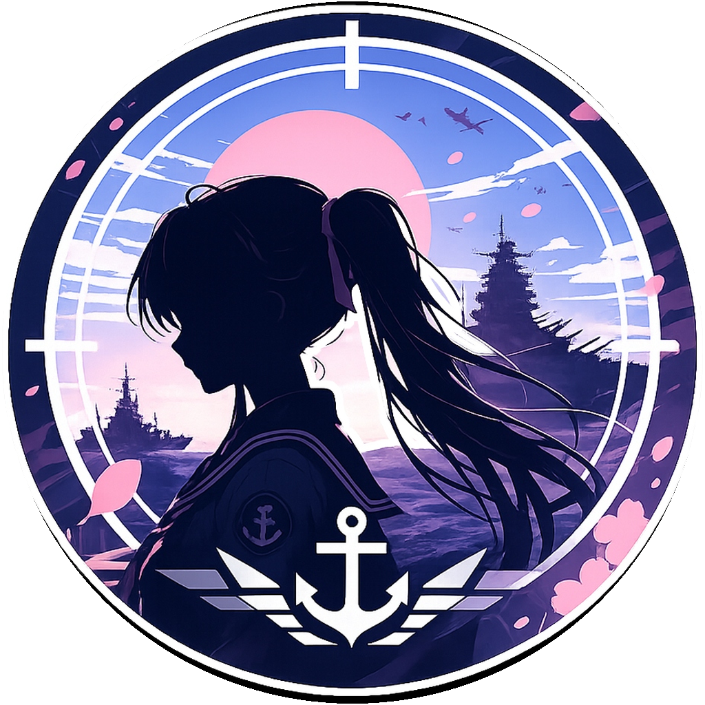

  

# ヤハギ

[Yahagi KanColle Browser](https://github.com/yamatosaki/yahagi-kancolle-browser)의 iOS 이식판

[릴리스](https://github.com/Kutinana/yahagi-kancolle-browser/releases) · [iOS 문제 제보](https://github.com/Kutinana/yahagi-kancolle-browser/issues) · [업스트림 프로젝트](https://github.com/yamatosaki/yahagi-kancolle-browser)

[简体中文](README.md) ｜ [繁體中文](README.zh-Hant.md) ｜ [日本語](README.ja.md) ｜ [English](README.en.md) ｜ 한국어

이 저장소는 비공식 독립 포크입니다. 공통 로직과 UI는 업스트림 저장소를 따르며, 새로운 기능 코드를 추가하지 않고 iOS 시스템의 특성에 맞춰 플랫폼 대응을 진행합니다.

Android 버전의 설치 파일과 전체 기능 소개는 [업스트림 프로젝트](https://github.com/yamatosaki/yahagi-kancolle-browser)를 참고해 주세요.

## 다운로드 및 설치

이 저장소의 [Releases](https://github.com/Kutinana/yahagi-kancolle-browser/releases)에서 최신 릴리스의 .ipa 파일을 받을 수 있습니다.

.ipa 파일은 iOS 시스템의 앱 패키지 파일입니다. 이 프로젝트는 App Store에 등록되어 있지 않으므로 사이드로딩(Sideload)을 통해 기기에 직접 설치해야 합니다. 사이드로딩 방법은 [AltStore](https://altstore.io/) 또는 [Sideloadly](https://sideloadly.io/)를 참고해 주세요.

## 제한 사항

- **앱 내 프록시:** iOS 17 이상에서는 기반 API가 공개되어 앱 내에서 전용 HTTP/SOCKS5 프록시를 설정할 수 있습니다. iOS 15–16은 이 기능을 지원하지 않으며 시스템 네트워크(전역 프록시)만 사용할 수 있습니다.

- **MOD 및 캐시:** iOS는 전체 게임 리소스 캐시와 게임 MOD를 제공할 수 없습니다.

- **백그라운드 실행 유지:** iOS는 Android 포그라운드 서비스와 같은 방식으로 게임을 백그라운드에서 계속 실행할 수 없어 해당 설정을 사용할 수 없습니다. 알림과 백그라운드 오디오도 시스템 권한과 앱 실행 상태의 영향을 받습니다.

Apple은 2027년 봄에 iOS 앱의 최소 지원 버전을 iOS 15.0으로 공식적으로 상향할 예정입니다. 따라서 이 프로젝트는 iOS 15.0 미만의 시스템을 지원하지 않습니다. 가능하다면 최신 버전의 iOS와 사이드로딩 도구를 사용하시기를 권장합니다.

## 기타

사용 중 문제가 발생하면 언제든지 이 저장소에 [Issue](https://github.com/Kutinana/yahagi-kancolle-browser/issues)를 제출해 주세요. 버전, 기기, OS, 재현 절차를 함께 첨부해 주시기 바랍니다. 동영상이나 GitHub에 업로드하기 어려운 첨부 파일을 보내려면 kanade@yoisaki.com으로도 연락하실 수 있습니다.

이 저장소는 새로운 기능을 추가하지 않으므로, 공통 기능에 대한 질문이나 제안은 업스트림 저장소의 [교류 및 피드백](https://github.com/yamatosaki/yahagi-kancolle-browser#%E4%BA%A4%E6%B5%81%E4%B8%8E%E5%8F%8D%E9%A6%88)으로 연락해 보시기 바랍니다.

이 프로젝트는 업스트림 프로젝트의 비공식 파생판입니다. 데이터 처리, 개인정보 처리방침, 라이선스 등은 업스트림 저장소를 기준으로 합니다.
