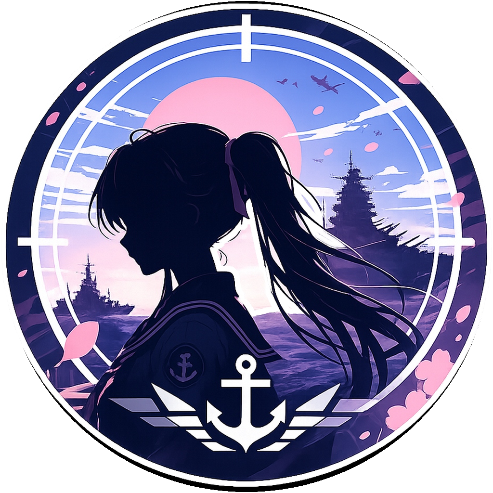

  

# ヤハギ

[Yahagi KanColle Browser](https://github.com/yamatosaki/yahagi-kancolle-browser) 的 iOS 移植版

[发布版本](https://github.com/Kutinana/yahagi-kancolle-browser/releases) · [iOS 问题反馈](https://github.com/Kutinana/yahagi-kancolle-browser/issues) · [上游项目](https://github.com/yamatosaki/yahagi-kancolle-browser)

简体中文 ｜ [繁體中文](README.zh-Hant.md) ｜ [日本語](README.ja.md) ｜ [English](README.en.md) ｜ [한국어](README.ko.md)

本仓库为非官方独立分支，共享业务与界面跟随上游仓库，不新增功能性代码，并按 iOS 系统的具体情况进行平台适配。

有关 Android 版本的获取及完整功能介绍，请参见 [上游项目](https://github.com/yamatosaki/yahagi-kancolle-browser)。

## 获取与安装

您可以从本仓库的 [Releases](https://github.com/Kutinana/yahagi-kancolle-browser/releases) 获取到最新发布的 .ipa 文件。

.ipa 文件是 iOS 系统的应用包体文件。本项目并未上架 App Store，因此您需要通过侧载（Sideload）在您的设备上自行安装本软件。关于如何进行侧载，请参见 [AltStore](https://altstore.io/) 或 [Sideloadly](https://sideloadly.io/)。

## 限制

- **应用内代理：** iOS 17 及以上开放了底层 API，支持应用内设置专有的 HTTP/SOCKS5 代理。iOS 15–16 不支持该功能，仅能使用系统网络（全局代理）。

- **魔改与缓存：** iOS 无法提供完整游戏资源缓存、游戏魔改。

- **后台保活：** iOS 无法提供与 Android 前台服务相同的后台保持游戏能力，相关设置不可用；通知和后台声音仍受系统权限与运行状态影响。

请注意，Apple 将于 2027 年春季正式将 iOS 应用最低支持版本拉升至 iOS 15.0，因此本项目不支持 iOS 15.0 以下的系统。若有条件，建议您使用最新版的 iOS 系统与侧载工具。

## 其它

若您在使用过程中遇到问题，您可以随时向本仓库提交 [Issue](https://github.com/Kutinana/yahagi-kancolle-browser/issues)，并请附上版本、设备、系统和复现步骤。若您希望发送视频或其他不易在 Github 平台上传的附件，您也可以使用 kanade@yoisaki.com 联系我。

本仓库不新增任何功能，因此若出现通用功能的疑问或建议，请考虑联系上游仓库 [交流与反馈](https://github.com/Kutinana/yahagi-kancolle-browser#%E4%BA%A4%E6%B5%81%E4%B8%8E%E5%8F%8D%E9%A6%88)。推荐您加入官方交流 QQ 群：1104904097。

本项目为上游项目的非官方衍生版本，数据处理、隐私政策、License 等请以上游仓库为准。